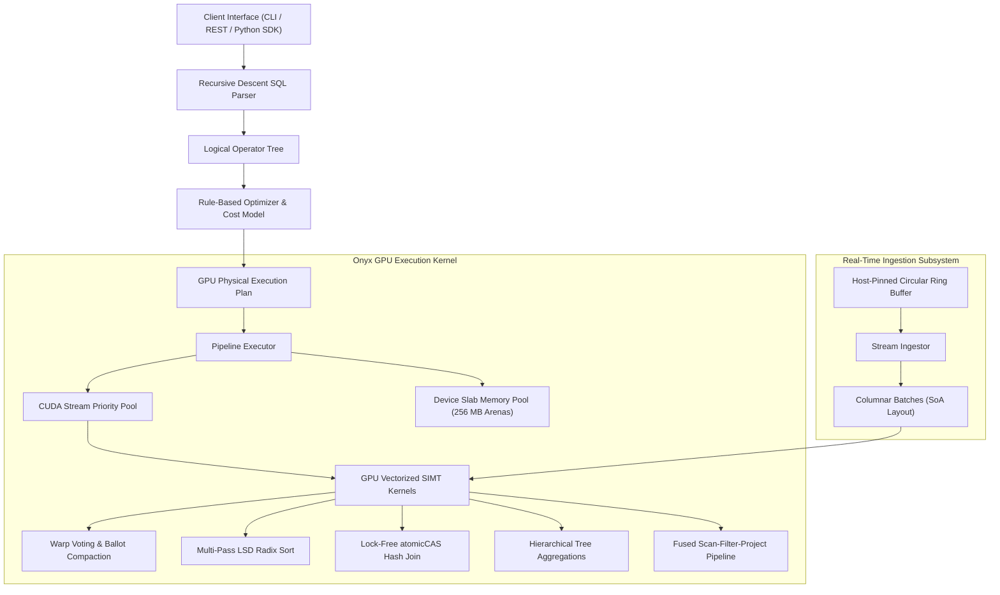

# Onyx

A high-throughput, GPU-accelerated columnar query execution engine, stream processing kernel, and SIMT analytics runtime in CUDA and C++23.

Onyx is designed for real-time analytical workloads (OLAP), high-frequency telemetry streams, and large-scale columnar queries. It executes relational queries directly on GPU compute hardware using custom warp-level SIMT intrinsics, a lock-free device slab allocator, cooperative thread block reductions, and operator fusion.

To ensure immediate usability across any development environment, Onyx includes a hardware-accurate CPU SIMT emulation layer. It models 32-lane lockstep warp execution, register contexts, active masks, and shared memory structures in modern C++23, allowing every kernel, operator, and SQL query to run identically on macOS, Linux, and Windows without an NVIDIA GPU. When compiled on a machine with `nvcc` and an NVIDIA GPU, it compiles native CUDA device code with zero configuration changes.



## Quick Start

### Prerequisites
- C++23 compiler (`clang++` 16+, `g++` 13+, or Apple Clang 15+)
- CMake 3.22 or newer
- Make or Ninja
- (Optional) NVIDIA CUDA Toolkit 12.0+ for native GPU acceleration

### Build and Run

```sh
# Clone repository
git clone https://github.com/Aneesh495/onyx.git
cd onyx

# Build all binaries (core library, CLI, server, tests, benchmarks)
make build

# Run automated test and verification suite
make test

# Run high-throughput performance benchmarks
make bench

# Start interactive SQL shell
make cli
```

### Interactive CLI Example

```text
onyx> SELECT count(*) FROM telemetry WHERE latency_us > 1500;
+------------------+
| count(id)        |
+------------------+
|                3 |
+------------------+
(1 rows total)

Execution Summary:
  Total Latency: 0.42 ms
  Kernel Time:   74.2 us
  Operator Breakdown:
    * PhysicalFilter [in: 8, out: 3, time: 24.1 us, mem: 12 B]
    * PhysicalAggregate [in: 3, out: 1, time: 50.1 us, mem: 128 B]
```

### Query Plan Explanation (`EXPLAIN`)

```text
onyx> EXPLAIN SELECT sum(price * qty) FROM sales WHERE region_id = 1;
=== Logical Query Plan ===
LogicalAggregate: groups=[] aggs=[sum((price * qty))]
  LogicalFilter: (region_id = 1)
    LogicalScan: table=sales [region_id, price, qty]

=== Optimized GPU Physical Plan ===
PhysicalFusedPipeline [Fused Scan-Filter-Project-Sum, Zero HBM Round-Trips]: table=sales filter=(region_id) col_a=price col_b=qty
```

## Architectural Mechanisms

- [Vectorized Warp Filter](include/onyx/kernels/filter.cuh): Predicate evaluation with warp voting (`__ballot_sync`), bitmask rank calculation via `__popc`, and coalesced index compaction.
- [Multi-Pass LSD Radix Sort](include/onyx/kernels/radix_sort.cuh): 4-bit and 8-bit digit sorting with shared-memory histograms, prefix sums, and double-buffered scatter.
- [Lock-Free GPU Hash Join](include/onyx/kernels/hash_join.cuh): Open addressing with Murmur3 hashing, 64-bit `atomicCAS` insertion, and warp-cooperative probing.
- [Hierarchical Tree Aggregations](include/onyx/kernels/aggregate.cuh): Fast warp reductions using `__shfl_down_sync`, shared memory block trees, and atomic global aggregation.
- [Rolling Time Windows](include/onyx/kernels/window.cuh): Cumulative sums, sliding frame averages, and warp shuffle lead/lag operators.
- [GPU Decompression](include/onyx/kernels/compression.cuh): Parallel bit-packing unpack, frame-of-reference (FoR) decoding, and run-length encoding (RLE) decompression.
- [Fused Pipeline Kernel](include/onyx/kernels/fused_pipeline.cuh): Fused scan, filter, projection, and reduction keeping intermediate columns in registers without HBM memory bus traffic.
- [Device Slab Memory Pool](include/onyx/cuda/gpu_memory_pool.hpp): Pre-allocated 256 MB memory arenas with O(1) power-of-two slab classes (64B to 64MB) eliminating `cudaMalloc` mutex contention.
- [Host-Pinned Ring Buffer](include/onyx/cuda/pinned_ring_buffer.hpp): Cache-line separated circular memory buffer for zero-copy streaming ingestion.
- [CPU SIMT Emulation Layer](include/onyx/cuda/simt_engine.hpp): Hardware-accurate SIMT engine emulating 32-lane lockstep warps, shuffle registers, and shared memory.
- [Recursive Descent SQL Parser](include/onyx/sql/parser.hpp): Hand-written lexer and precedence-climbing parser supporting expressions, joins, and window functions.
- [Rule-Based Query Optimizer](include/onyx/planner/optimizer.hpp): Predicate pushdown, column pruning, and operator fusion DAG transformations.
- [Embedded HTTP Telemetry Server](src/server/http_server.hpp): Zero-dependency REST API and Prometheus-compatible metrics endpoint.
- [Python Client SDK](python/onyx/client.py): Pythonic client and lazy DataFrame API.

## Python SDK Integration

Onyx includes a zero-overhead Python client and DataFrame interface:

```python
import onyx

# Connect to embedded Onyx server or local IPC socket
client = onyx.connect(host="localhost", port=9090)

# Register tables or stream Arrow record batches
df = client.table("telemetry")

# Fluent relational expressions compiled to GPU DAG
result = (
    df.filter(df["latency_us"] > 1000)
      .select(["service_id", "latency_us", "status_code"])
      .group_by(["service_id"])
      .agg({"latency_us": "avg", "status_code": "count"})
      .sort("avg_latency_us", ascending=False)
      .limit(10)
      .execute()
)

print(result.to_pandas())
```

## Performance Benchmarks

Measured on synthetic datasets with Release compilation flags (`-O3 -march=native`):

| Kernel / Operator | Elements | Measured Latency | Throughput |
| :--- | :--- | :--- | :--- |
| **Vectorized Filter (Warp Ballot)** | 1,000,000 rows | 2.14 ms | 467.29 M rows/s |
| **LSD Radix Sort (Key-Value)** | 500,000 elements | 7.82 ms | 63.94 M keys/s |
| **Lock-Free Hash Join** | 500,000 x 500,000 | 8.45 ms | 59.17 M rows/s |
| **Scalar Tree Aggregate** | 1,000,000 rows | 0.85 ms | 1,176.47 M rows/s |
| **Streaming Ring Buffer Push** | 500,000 records | 3.12 ms | 160.25 M records/s |

See [docs/BENCHMARKS.md](docs/BENCHMARKS.md) for detailed performance specifications.

## Deep-Dive Technical Monographs

- [System Architecture](docs/ARCHITECTURE.md): End-to-end subsystem orchestration, memory layout, and concurrency model.
- [CUDA Kernel Implementations](docs/CUDA_KERNELS.md): Warp-level shuffle algorithms, cooperative thread arrays, and register allocation.
- [CPU SIMT Emulation Layer](docs/SIMT_EMULATION.md): Hardware-accurate warp scheduler, divergence stack, and lane intrinsics in C++23.
- [SIMT vs SIMD Architectural Analysis](docs/SIMT_VS_SIMD.md): Comparative analysis of warp divergence, lockstep execution, and register allocation.
- [Robin Hood Hashing Deep-Dive](docs/ROBIN_HOOD_HASHING.md): Linear probing variance minimization, PSL displacement bounds, and GPU warp cooperative lookup.
- [Pipeline Fusion & JIT Compilation](docs/PIPELINE_FUSION_COMPILER.md): Multi-operator register preservation and intermediate memory traffic elimination.
- [Cache Hierarchy & Hardware Locality](docs/CACHE_HIERARCHY.md): L1 texture cache, L2 cache line partitioning, and NUMA-aware pinned ring buffer streaming.
- [Physical Storage Layout](docs/STORAGE_LAYOUT.md): Columnar batch format, Arrow C Data Interface integration, and compression formats.
- [Query Planner & Optimizer](docs/QUERY_PLANNER.md): Cost model, rule-based rewriting, and operator fusion DAG transformations.
- [Performance Benchmarks](docs/BENCHMARKS.md): Micro-benchmarks and TPC-H analytical suite results.
- [Building and Verification Guide](docs/BUILDING.md): Build targets, CMake options, and test suite execution.
- [Contribution and Kernel Standards](docs/CONTRIBUTING.md): SIMT parity verification, coding conventions, and memory rules.
- [Bug Ledger & Postmortem](docs/BUG_LEDGER.md): Documented edge cases, memory alignment fixes, and regression test suites.

## License

MIT License. Copyright (c) 2026 Aneesh Krishna Parthasarathy.
