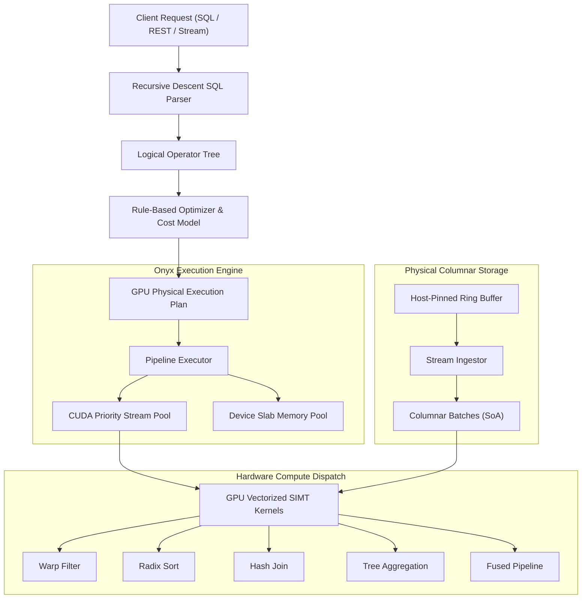

# Onyx Architecture Specification

Onyx is a high-throughput, GPU-accelerated columnar query execution engine and streaming analytics kernel designed for massive parallel analytical processing on modern hardware.

## System Principles

### 1. Coalesced Memory Access and Structure of Arrays
All columnar data in Onyx is organized in Structure of Arrays (SoA) format. Each column array is aligned to 128-byte boundaries matching GPU memory transaction sizes. When 32 threads in a warp access consecutive column elements, the hardware GPU memory controller coalesces the 32 individual 4-byte reads into a single 128-byte bus transaction, achieving close to theoretical memory bandwidth.

### 2. Dual-Tier Memory Management
Standard memory allocation via `cudaMalloc` and `cudaFree` introduces costly driver mutex contention and device synchronization barriers. Onyx bypasses runtime driver allocation through a dedicated device slab memory pool (`GpuMemoryPool`):
- Memory arenas of 256 MB are pre-allocated upfront.
- Allocations are partitioned into power-of-two slab classes from 64 bytes up to 64 megabytes.
- Allocation and deallocation are O(1) operations managed by thread-safe free lists.

### 3. Warp-Level SIMT Primitives
Instead of using thread-block barriers (`__syncthreads()`) and shared memory for intra-warp coordination, Onyx utilizes low-overhead warp intrinsics:
- Warp Voting (`__ballot_sync`): Predicate evaluation produces a 32-bit bitmask in a single clock cycle.
- Warp Compaction: Active lanes compute target compaction write offsets using `__popc(mask & lane_mask_lt(lane_id()))`.
- Warp Shuffle Reductions: Kogge-Stone butterfly exchange networks (`__shfl_down_sync`) compute prefix sums and reductions directly within registers without shared memory bank conflicts.

### 4. Operator Fusion
Traditional query execution engines materialize intermediate columns into global device memory between operators. For queries with filters, projections, and aggregations, Onyx fuses the entire pipeline into a single CUDA kernel. Data is fetched once from device memory, filtered in registers, transformed in registers, and reduced in shared memory, eliminating redundant round-trips to High Bandwidth Memory (HBM).

### 5. Hardware-Accurate SIMT Emulation
To ensure full portability across developer environments, Onyx features a hardware-accurate CPU SIMT emulation layer. It models 32-thread lockstep execution, warp shuffling, and shared memory structures in modern C++23, allowing every kernel, operator, and query to execute and pass verification on standard CPU targets without modifying kernel logic.
